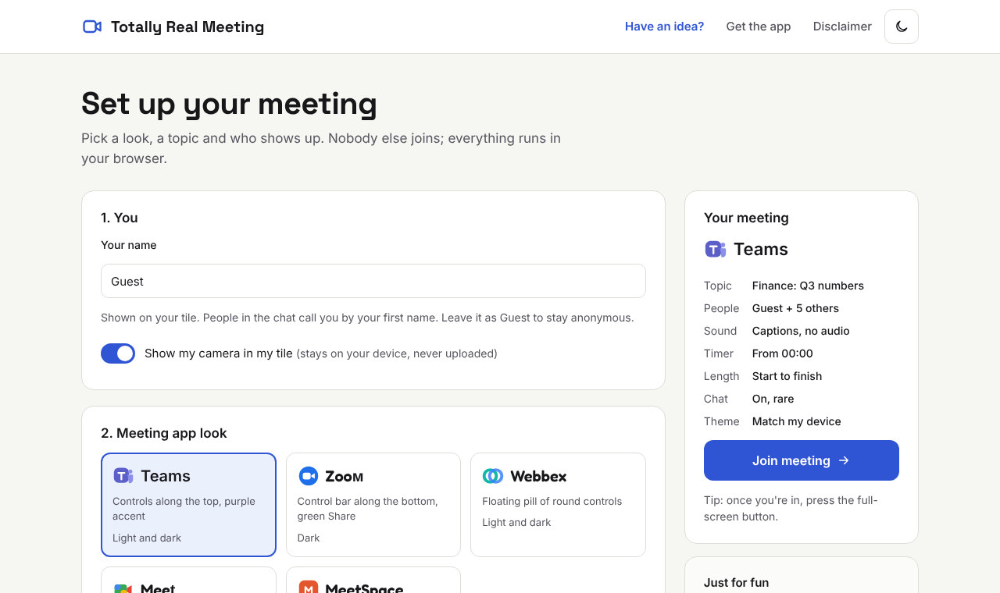
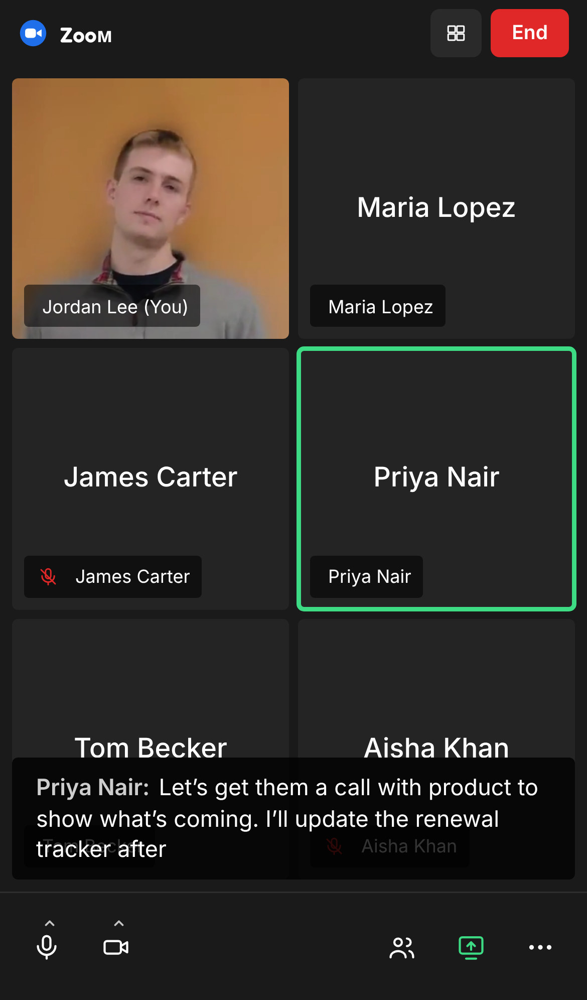
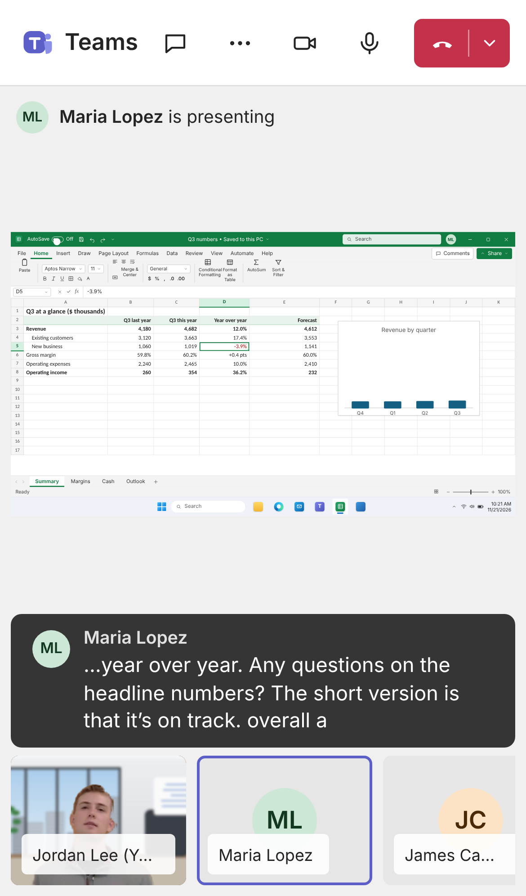

# Totally Real Meeting

**A parody video call that looks and behaves like the apps you already know.** Pick an app look, a topic and who shows up, then join a meeting that feels lived-in: people arrive, talk, react and reply to you in the chat.

**Try it live: https://openeli.github.io/totally-real-meeting/**

> Made for fun. The meeting screens are parodies of popular apps and are not affiliated with or endorsed by their makers. Don't use it to mislead anyone. [Read the full disclaimer](https://openeli.github.io/totally-real-meeting/disclaimer.html).

## Screen sharing, background effects and video meetings

Every picture below opens that meeting on the live site. Hover over one to see which meeting it is and when in the call it was captured.

| Finance spreadsheet, shared in Zooм | Training deck, shared in Meeṭ |
|---|---|
| [.")](https://openeli.github.io/totally-real-meeting/meeting.html?s=%7B%22skin%22%3A%22zoom%22%2C%22topic%22%3A%22Finance%22%2C%22timer%22%3A15%7D) | [, Meeṭ, 15:14 into the call. Captured Nov 21, 2026, 10:20 AM MST. Click to open this meeting (camera and mic check first).")](https://openeli.github.io/totally-real-meeting/meeting.html?s=%7B%22skin%22%3A%22meet%22%2C%22topic%22%3A%22Absurd%20corporate%20training%22%2C%22timer%22%3A15%7D) |
| **Mandatory Fun: Doug shares his desktop (Teаms)** | **Background effects (Teаms)** |
| [.")](https://openeli.github.io/totally-real-meeting/meeting.html?s=%7B%22skin%22%3A%22teams%22%2C%22audio%22%3Atrue%2C%22sample%22%3A%22humorvid%22%7D&at=168) | [.")](https://openeli.github.io/totally-real-meeting/meeting.html?s=%7B%22skin%22%3A%22teams%22%2C%22topic%22%3A%22Product%20roadmap%22%2C%22fx%22%3A%22bg%3Aoffice%22%7D) |

### Team connect hour with filmed participants (Webbex)

[.")](https://openeli.github.io/totally-real-meeting/meeting.html?s=%7B%22skin%22%3A%22webex%22%2C%22audio%22%3Atrue%2C%22sample%22%3A%22hour%22%7D&at=1500)

## A look inside

The chat, menus and settings work in every app look, each drawn in that app's own style.

| Meeting chat that answers you (Teаms) | Participants and Mute All (Zooм) |
|---|---|
| [.")](https://openeli.github.io/totally-real-meeting/meeting.html?s=%7B%22skin%22%3A%22teams%22%2C%22topic%22%3A%22Marketing%22%2C%22timer%22%3A15%7D) | [.")](https://openeli.github.io/totally-real-meeting/meeting.html?s=%7B%22skin%22%3A%22zoom%22%2C%22topic%22%3A%22Sales%22%2C%22timer%22%3A30%2C%22fx%22%3A%22blur%22%7D) |
| **In-call settings (Webbex)** | **More menu in dark mode (Teаms)** |
| [.")](https://openeli.github.io/totally-real-meeting/meeting.html?s=%7B%22skin%22%3A%22webex%22%2C%22topic%22%3A%22HR%22%2C%22timer%22%3A15%7D) | [.")](https://openeli.github.io/totally-real-meeting/meeting.html?s=%7B%22skin%22%3A%22teams%22%2C%22theme%22%3A%22dark%22%2C%22topic%22%3A%22Town%20hall%22%2C%22timer%22%3A30%2C%22count%22%3A9%2C%22fx%22%3A%22blur%22%7D) |
| **Raised hand and reactions (Meeṭ)** | **Your own app (HuddleHub)** |
| [.")](https://openeli.github.io/totally-real-meeting/meeting.html?s=%7B%22skin%22%3A%22meet%22%2C%22topic%22%3A%22Budget%20review%22%2C%22timer%22%3A15%7D) | [.")](https://openeli.github.io/totally-real-meeting/meeting.html?s=%7B%22skin%22%3A%22custom%22%2C%22topic%22%3A%22Engineering%20standup%22%2C%22timer%22%3A15%2C%22customApp%22%3A%7B%22name%22%3A%22HuddleHub%22%2C%22color%22%3A%22%230F9D8A%22%2C%22letter%22%3A%22H%22%2C%22shape%22%3A%22circle%22%2C%22layout%22%3A%22pill%22%7D%7D) |
| **Pre-join screen with camera check (Meeṭ)** | **After the call, with Rejoin (Zooм)** |
| [.")](https://openeli.github.io/totally-real-meeting/meeting.html?s=%7B%22skin%22%3A%22meet%22%2C%22topic%22%3A%22Product%20roadmap%22%2C%22fx%22%3A%22blur%22%7D) | [.")](https://openeli.github.io/totally-real-meeting/meeting.html?s=%7B%22skin%22%3A%22zoom%22%2C%22topic%22%3A%22Leadership%22%2C%22timer%22%3A30%7D) |

  
  &nbsp;
  

## Why it stands out

Most fake call pages give you one screen and a frozen grid of faces. This one is built to hold up for a whole meeting.

- **Four app looks, not one.** Teаms, Zooм, Webbex and Meeṭ each copy their own app's layout, colours, typeface, wording, menus and settings, down to the small things: Zooм shows names instead of initials when a camera is off, Meeṭ shows a blue talking indicator, and each app styles its captions its own way. There is no single design dressed up four ways.
- **Or design your own app.** Choose a name, logo letter, brand colour, logo shape and one of three layouts (controls on top, a bottom bar or a floating pill).
- **The whole call, start to finish:**
  - **Before:** each app's own pre-join screen with a camera preview and mic and camera toggles, plus Teаms's audio options and Meeṭ's device pickers.
  - **During:** a connecting step, then people drop in one by one.
  - **After:** each app's own leave and end steps lead to an after-call screen with Rejoin and a quality rating.
  - **Rejoin like it's real:** leave for five minutes and the meeting is five minutes further on when you come back, with the same people. If it ended while you were away, you see the host's "meeting ended" screen. A new meeting, or one that was ended for everyone, starts fresh.
- **A meeting that runs about an hour, then ends.** It opens with small talk while people wait, works through four agenda items, then wraps up with a recap, action items and goodbyes. People leave one by one and the host ends the meeting, shown the way each app shows it (Zooм pops up "This meeting has been ended by host"). Prefer it to go on forever? Turn on **Meeting on a loop**. The talk keeps going, but once a normal meeting would have ended the chat goes quiet, and people only answer what you type.
- **Jokes and side-tracks, if you want them.** Now and then someone talks on mute, a cat walks across a keyboard, or the meeting drifts onto lunch spots before the host pulls it back. One switch keeps the meeting strictly on topic instead.
- **Live captions that flow.** Words appear one or two at a time as people speak. While someone talks, the text is lowercase and unpunctuated, now and then with a misheard word. When the sentence ends, it settles into its final form, the same way real captions behave.
- **Screen sharing.** In Finance, the host presents a spreadsheet on a Windows 11 desktop and moves to the next sheet with each agenda item; the figures on screen match the ones spoken in the captions. In the email etiquette training, the trainer opens a deck on a Mac and plays it as a slide show. In Mandatory Fun, Doug shares his entire desktop by mistake, and Brenda later presents the company values poster. Each app frames a share its own way (Zooм's "You are viewing" bar, Teаms' "is presenting" header), participants move to a strip, and captions get a dedicated band below the shared screen so they never cover it. The office apps are lookalikes drawn in HTML and CSS, which keeps them lightweight and sharp at any size. A single switch on the setup page turns sharing off.
- **Conversations that fit the topic.** Ten ready-made topics, from Budget review to Town hall, each come with their own meeting title, agenda, captions, action items and chat lines. You can also write your own topic.
- **Scenarios for a laugh.** Five more topics play it for comedy: Absurd corporate training, Completely pointless brainstorming, Corporate disaster meeting, IT outage and Monday morning status meeting.
- **A wildcard in the room.** Optionally give one participant a personality: the talker who never lets go of the floor, the know-it-all with a correction for everything, or the confused manager who is lost but supportive. They speak up more, have their own lines and little scenes, and type in the chat in character.
- **A chat that answers you.** Say "hello" and someone welcomes you by your first name ("better late than never" if you joined late, "welcome back" after a Rejoin). Ask "can you hear me?" and the reply depends on whether your mic is muted. "Can you see me?" depends on your camera. People pause, show "is typing…", then reply.
- **People who act like people.**
  - One person talks for a while before passing the floor on, and someone chips in with an "mm-hmm".
  - Reactions and raised hands are rare and random, and whoever raises a hand speaks next.
- **Working menus.** These all open and work, drawn in each app's own style:
  - People, with mute toggles and Mute all
  - Raise hand, reactions and gallery or speaker view
  - Record (just a red pill, nothing is saved), captions and meeting info
  - In-call settings
- **Your real camera, if you want it.** Your webcam shows in your own tile and never leaves your device.
- **Background effects on your camera.** Blur your background or replace it with a picture, from each app's own menu: Teаms "Background effects", Zooм "Background & effects", Webbex "Virtual background" and Meeṭ "Effects" (including Meet's lighter "Slightly blur"). The panel opens from the pre-join screen, from More, or from the Video settings. Processing runs entirely in your browser with Google's MediaPipe selfie segmenter, which loads only once you pick an effect. The site remembers your choice.
- **Steady video tiles.** In the meetings with filmed participants, cameras stay on for most of the call. A camera that switches off remains off for at least 45 seconds, one that returns stays on for at least a minute, and no two camera changes happen within 20 seconds of each other anywhere in the meeting, so the grid never flickers.
- **Fits your situation.** The call clock can start at 00:00, 15 minutes, 30 minutes or 1 hour. Join late and you skip the opening and land partway through the agenda, with everyone already there. You can set the participant count (1 to 16), edit or shuffle their names, and turn chat on or off.
- **Light and dark.** The setup page follows your device or your choice. So do the app looks that have a light mode in real life.
- **Phones too.** Every look adapts to small screens, for example Zooм's End button moves to the top, like the mobile app.
- **Private and simple.** It's a static site with no accounts, no analytics and no server. Everything runs in your browser.

## How to use it

1. Open the [live site](https://openeli.github.io/totally-real-meeting/).
2. Pick an app look, a topic, the sound and timer, and who's in the meeting.
3. Press **Join meeting**, check your camera on the pre-join screen, then join.
4. Use full screen for the most convincing view.

## Use it like an app

On an iPhone or iPad, open the setup page in Safari, tap Share, then **Add to Home Screen**. The **Get the app** link at the top of the setup page walks through it with pictures. Opened from that icon, the site runs on its own, like an app: no address bar, and the setup page, the call and the disclaimer open inside it, fading from one to the next. On Android, Chrome offers **Install app** or **Add to Home screen** in its menu.

If you added an icon before this existed, remove it and add it again so your phone picks up the app settings.

## Sound

Pick one on the setup page:

- **No audio, captions on** (default): the meeting is silent and what people say appears as live captions. You can turn captions off during the call.
- **With audio and video: 15 min (preview)**: you join a “team connect” that has been going for 15 minutes, partway through someone’s answer, and it runs about 15 more minutes with sound and captions off. Six coworkers (three pairs) answer questions on camera. The host types the questions in the chat and the camera-off colleagues only chat, so every voice comes from the people on camera.
- **With audio and video: full hour (preview)**: the whole “team connect hour”, about 58 minutes. The host and two colleagues speak with computer voices between the answers. Cameras stay on for most of the meeting and switch off only occasionally, as they would in a real call, and backgrounds are blurred.

Or pick the comedy, **Mandatory Fun: Quarterly Vibe Check** (about 13 minutes). It is a team “fun” meeting where small things keep going wrong: a morale survey, a wellness minute, an escape room offsite, and a manager who talks to his desk lamp. The jokes are original. It plays three ways:

- **No audio, captions on**: silent, with every line as a caption.
- **AI voices**: five characters speak with computer voices, cameras off.
- **AI voices and video**: the same, plus four filmed coworkers on camera who stay muted and only listen. Their backgrounds are blurred more heavily, and their cameras go off now and then.

In every mode your own participant names join muted with their cameras off and only use the chat.

These prepared meetings have their own title, people and start time, so the setup page fills those in and locks them.

The on-camera people are real volunteers from the [Seamless Interaction dataset](https://ai.meta.com/research/seamless-interaction/) by Meta, used under [CC BY-NC 4.0](https://creativecommons.org/licenses/by-nc/4.0/), so the site stays non-commercial. The clips were cropped, trimmed and reordered, and their backgrounds blurred. The computer voices (in the full hour and the comedy) come from the [Kokoro](https://github.com/hexgrad/kokoro) text-to-speech model (Apache 2.0).

## For developers

No build step and no server: open `index.html` in a browser.

### Files
- `index.html`: the setup page with every setting, the "Have an idea?" popup and the short disclaimer.
- `meeting.html`: the meeting room. It draws the chosen look and runs the call.
- `disclaimer.html`: the full disclaimer.
- `app.html`: "Get the app", a step-by-step guide with iPhone lookalike pictures for adding the site to the Home Screen.
- `404.html`: the "meeting doesn't exist" page GitHub Pages shows for any broken link, with a Return to lobby button.
- `shared.js`: settings, parody logos, names, topics and chat lines.
- `talk.js`: what people say out loud (the captions): small talk, the agenda for each topic, jokes, side-tracks and the wrap-up. `MEETING_NUMS` picks the percentages and amounts once per meeting, so the captions and the shared spreadsheet agree.
- `share.js`: the shared screens (a Windows 11 spreadsheet, a Mac slide deck and a desktop with a browser), drawn in HTML and CSS at 1280×720 and scaled to fit. `SHARE_TOPICS` lists the topics that share and what they show; `SHARE_SAMPLE` places the shares on the timeline of a prepared meeting.
- `site.css`: styles for the setup and disclaimer pages.
- `effects.js` and `effects/`: background effects for your own camera. `effects.js` cuts you out of each frame with the MediaPipe selfie segmenter (the model file is in `effects/`; the MediaPipe code loads from jsDelivr only when an effect is turned on) and draws you over a blur or a picture. The pictures are drawn by `tools/effects/make_backgrounds.py`.
- `sample/` (the hour), `sample/short/` (15 minutes) and `sample/humor/` (Mandatory Fun): the audio and video meetings: one video per on-camera person, one voice track per camera-off person (all as long as the meeting, so they stay in sync), and `timeline.js` with who talks when, caption word timings, cameras on and off, typed chat messages, and when people join and leave. `tools/sample/` has the scripts that build it, including `restitch.py`, which re-plans the filmed tiles from existing renders, and `calm_cameras.py --check`, which verifies the camera rules (see `tools/sample/README.md`). Add `&at=SECONDS` to the meeting URL to jump in partway.
- `docs/`: screenshots for this page.

### Add or change content
All in `shared.js` unless noted:
- `TOPICS` and `TOPIC_TITLE`: topics and their meeting titles. The setup page lists them alphabetically, so the order here doesn't matter.
- In `talk.js`: `WILDCARDS` holds the three personalities (their lines, replies, little scenes with the role `W`, wrap-up moment and chat lines). The wildcard is always the third participant (or the second, if there are only two).
- In `talk.js`: `AGENDA` holds each topic's four agenda items and their lines, `ACTION_ITEMS` the closing to-dos, `MEETING_LINES` and `REPLY_LINES` the everyday talk, `BACKCHANNEL` the short "mm-hmm" lines, `JOKES` and `SIDE_TRACKS` the light moments, and `WRAP_START`, `RECAP`, `WRAP_END` and `GOODBYES` the ending. Multi-person exchanges use the roles `H` (host) and `A`, `B`, `C` (three different people).
- `CHAT_GENERIC` and `CHAT_TOPIC`: chat messages, by meeting phase and by topic.
- `CHAT_REPLIES`: rules for answering what the visitor types.
- `NAME_POOL` and `SPARE_NAMES`: participant names.
- `MISHEARD` in `meeting.html`: words the captions sometimes get wrong before correcting.

### Testing shortcuts
Add these to the end of the meeting page address:
- `&fast=1` makes chat messages, reactions and arrivals come within seconds.
- `&skip=1` skips the pre-join screen.
- `&endin=180` squeezes the whole meeting, from small talk to the host ending it, into that many seconds.

### Publish (GitHub Pages)
In the repository settings, open **Pages** and set the source to "Deploy from a branch", with branch `main` and folder `/ (root)`. The site updates a minute or two after every merge to `main`. A free GitHub account needs the repository to be public.

### Feedback messages
GitHub Pages can't receive form posts. To turn on the "Have an idea?" form, create a free form at formspree.io and paste its URL into `FEEDBACK_ENDPOINT` in `shared.js`.

### Planned
- Audio and video meetings on the other topics, and a choice of start time for them.

## Disclaimer

This is a parody made for entertainment only. Product names belong to their owners, and the lookalike screens are not the real apps. The names in the call are made up. The on-camera people in the audio and video meetings are research volunteers, not the people named. Don't use it to deceive anyone. See the [full disclaimer](https://openeli.github.io/totally-real-meeting/disclaimer.html).
