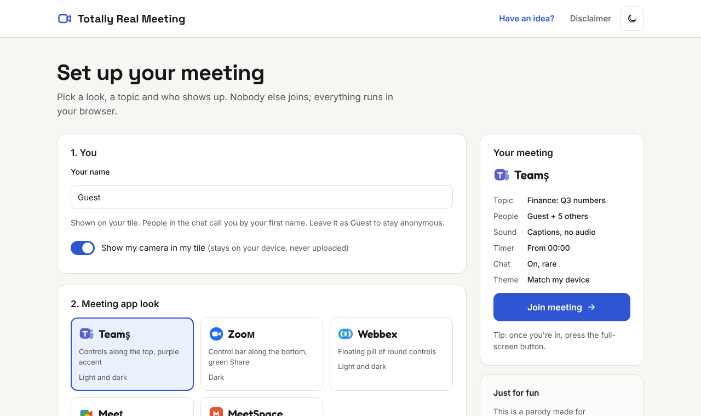
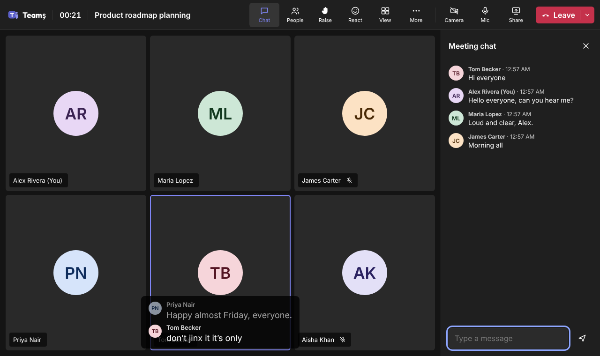
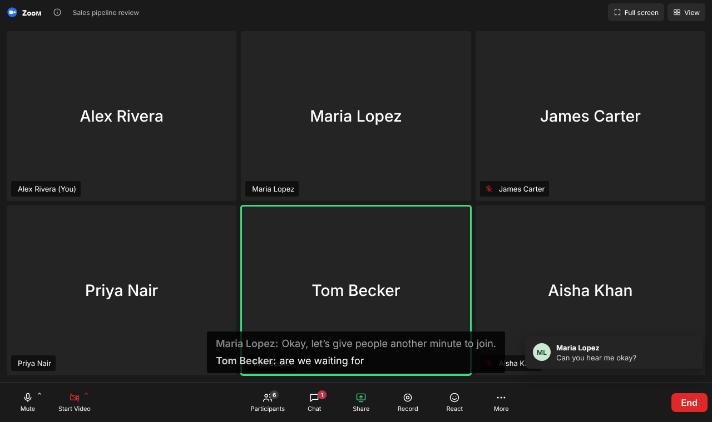
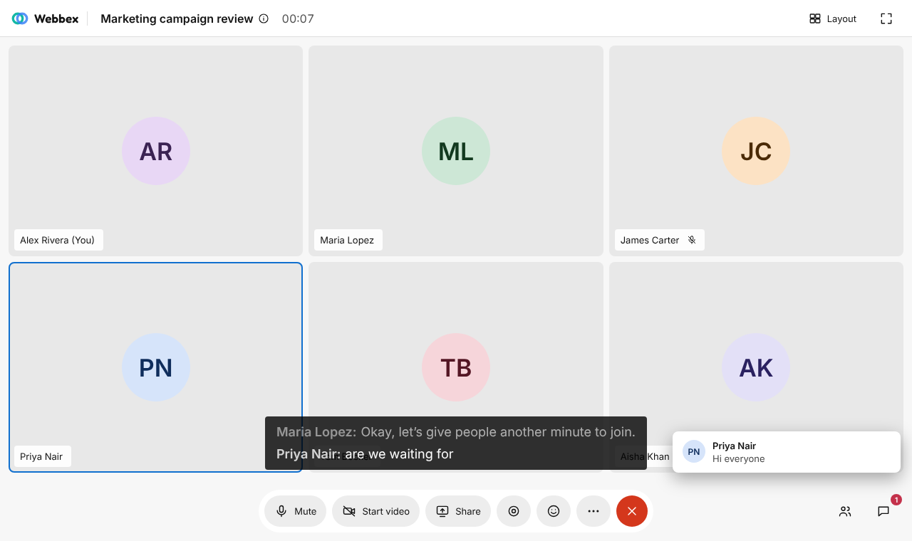
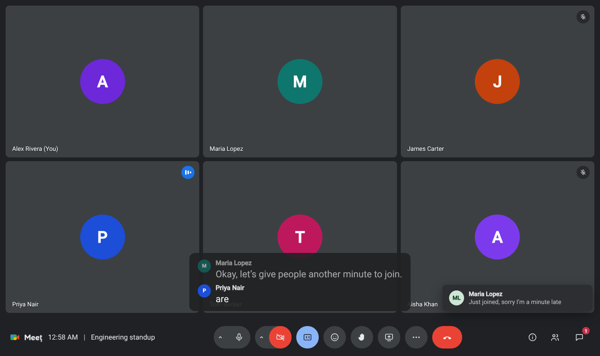
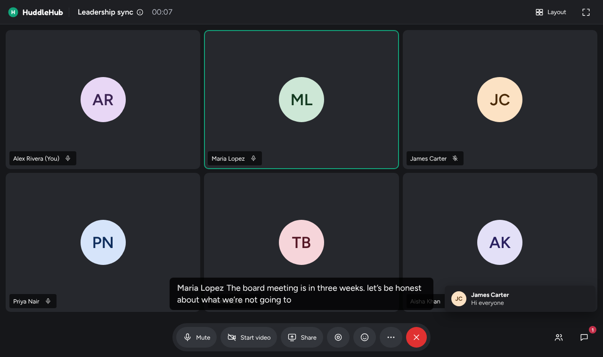
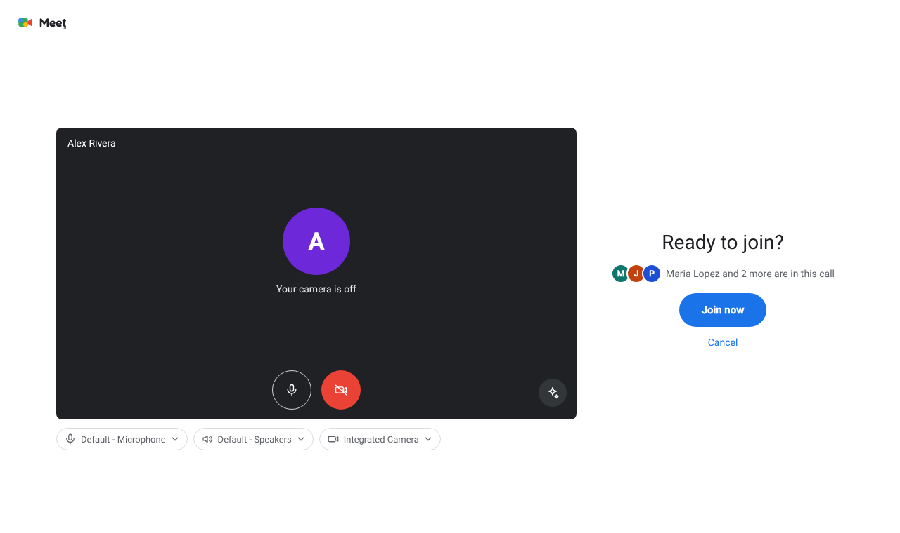
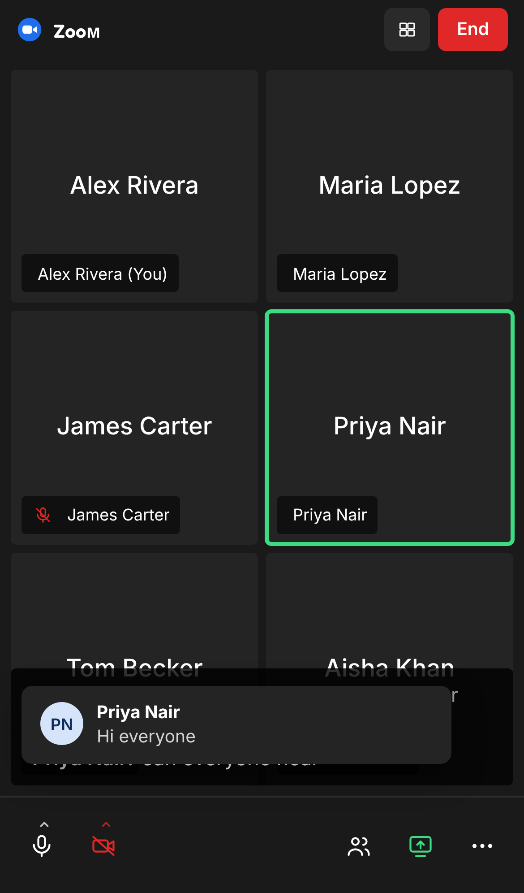

# Totally Real Meeting

**A parody video call that looks and behaves like the apps you already know.** Pick an app look, a topic and who shows up, then join a meeting that feels lived-in: people arrive, talk, react and reply to you in the chat.

**Try it live: https://openeli.github.io/totally-real-meeting/**

> Made for fun. The meeting screens are parodies of popular apps and are not affiliated with or endorsed by their makers. Don't use it to mislead anyone. [Read the full disclaimer](https://openeli.github.io/totally-real-meeting/disclaimer.html).

## Why it stands out

Most fake call pages give you one screen and a frozen grid of faces. This one is built to hold up for a whole meeting.

- **Four app looks, not one.** Teamş, Zooм, Webbex and Meeţ each copy their own app's layout, colours, typeface, wording, menus and settings, down to the small things: Zooм shows names instead of initials when a camera is off, Meeţ shows a blue talking indicator, and each app styles its captions its own way. There is no single design dressed up four ways.
- **Or design your own app.** Choose a name, logo letter, brand colour, logo shape and one of three layouts (controls on top, a bottom bar or a floating pill).
- **The whole call, start to finish:**
  - **Before:** each app's own pre-join screen with a camera preview and mic and camera toggles, plus Teamş's audio options and Meeţ's device pickers.
  - **During:** a connecting step, then people drop in one by one.
  - **After:** each app's own leave and end steps lead to an after-call screen with Rejoin and a quality rating.
  - **Rejoin like it's real:** leave for five minutes and the meeting is five minutes further on when you come back, with the same people. If it ended while you were away, you see the host's "meeting ended" screen. A new meeting, or one that was ended for everyone, starts fresh.
- **A meeting that runs about an hour, then ends.** It opens with small talk while people wait, works through four agenda items, then wraps up with a recap, action items and goodbyes. People leave one by one and the host ends the meeting, shown the way each app shows it (Zooм pops up "This meeting has been ended by host"). Prefer it to go on forever? Turn on **Meeting on a loop**. The talk keeps going, but once a normal meeting would have ended the chat goes quiet, and people only answer what you type.
- **Jokes and side-tracks, if you want them.** Now and then someone talks on mute, a cat walks across a keyboard, or the meeting drifts onto lunch spots before the host pulls it back. One switch keeps the meeting strictly on topic instead.
- **Live captions that flow.** Words appear one or two at a time as people speak. While someone talks, the text is lowercase and unpunctuated, now and then with a misheard word. When the sentence ends, it settles into its final form, the same way real captions behave.
- **Conversations that fit the topic.** Ten ready-made topics, from Budget review to Town hall, each come with their own meeting title, agenda, captions, action items and chat lines. You can also write your own topic.
- **A chat that answers you.** Say "hello" and someone welcomes you by your first name ("better late than never" if you joined late, "welcome back" after a Rejoin). Ask "can you hear me?" and the reply depends on whether your mic is muted. "Can you see me?" depends on your camera. People pause, show "is typing…", then reply.
- **People who act like people.**
  - One person talks for a while before passing the floor on, and someone chips in with an "mm-hmm".
  - Reactions and raised hands are rare and random, and whoever raises a hand speaks next.
- **Working menus.** These all open and work, drawn in each app's own style:
  - People, with mute toggles and Mute all
  - Raise hand, reactions and gallery or speaker view
  - Record (just a red pill, nothing is saved), captions and meeting info
  - In-call settings
- **Your real camera, if you want it.** Your webcam shows in your own tile and never leaves your device.
- **Fits your situation.** The call clock can start at 00:00, 15 minutes, 30 minutes or 1 hour. Join late and you skip the opening and land partway through the agenda, with everyone already there. You can set the participant count (1 to 16), edit or shuffle their names, and turn chat on or off.
- **Light and dark.** The setup page follows your device or your choice. So do the app looks that have a light mode in real life.
- **Phones too.** Every look adapts to small screens, for example Zooм's End button moves to the top, like the mobile app.
- **Private and simple.** It's a static site with no accounts, no analytics and no server. Everything runs in your browser.

## A look inside

| Teamş, with the chat open | Zooм |
|---|---|
|  |  |
| **Webbex (light)** | **Meeţ** |
|  |  |
| **Your own app (HuddleHub)** | **Meeţ pre-join screen** |
|  |  |

## How to use it

1. Open the [live site](https://openeli.github.io/totally-real-meeting/).
2. Pick an app look, a topic, the sound and timer, and who's in the meeting.
3. Press **Join meeting**, check your camera on the pre-join screen, then join.
4. Use full screen for the most convincing view.

## Sound

Pick one on the setup page:

- **No audio, captions on** (default): the meeting is silent and what people say appears as live captions. You can turn captions off during the call.
- **With audio and video: 15 min (preview)**: you join a “team connect” that has been going for 15 minutes, partway through someone’s answer, and it runs about 15 more minutes with sound and captions off. Six coworkers (three pairs) answer questions on camera. The host types the questions in the chat and the camera-off colleagues only chat, so every voice comes from the people on camera.
- **With audio and video: full hour (preview)**: the whole “team connect hour”, about 58 minutes. The host and two colleagues speak with computer voices between the answers. Cameras switch on and off as they would in a real call, and backgrounds are blurred.

Or pick the comedy, **Mandatory Fun: Quarterly Vibe Check** (about 13 minutes). It is a team “fun” meeting where small things keep going wrong: a morale survey, a wellness minute, an escape room offsite, and a manager who talks to his desk lamp. The jokes are original. It plays three ways:

- **No audio, captions on**: silent, with every line as a caption.
- **AI voices**: five characters speak with computer voices, cameras off.
- **AI voices and video**: the same, plus four filmed coworkers on camera who stay muted and only listen. Their backgrounds are blurred more heavily, and their cameras go off now and then.

In every mode your own participant names join muted with their cameras off and only use the chat.

These prepared meetings have their own title, people and start time, so the setup page fills those in and locks them.

The on-camera people are real volunteers from the [Seamless Interaction dataset](https://ai.meta.com/research/seamless-interaction/) by Meta, used under [CC BY-NC 4.0](https://creativecommons.org/licenses/by-nc/4.0/), so the site stays non-commercial. The clips were cropped, trimmed and reordered, and their backgrounds blurred. The computer voices (in the full hour and the comedy) come from the [Kokoro](https://github.com/hexgrad/kokoro) text-to-speech model (Apache 2.0).

## For developers

No build step and no server: open `index.html` in a browser.

### Files
- `index.html`: the setup page with every setting, the "Have an idea?" popup and the short disclaimer.
- `meeting.html`: the meeting room. It draws the chosen look and runs the call.
- `disclaimer.html`: the full disclaimer.
- `shared.js`: settings, parody logos, names, topics and chat lines.
- `talk.js`: what people say out loud (the captions): small talk, the agenda for each topic, jokes, side-tracks and the wrap-up.
- `site.css`: styles for the setup and disclaimer pages.
- `sample/` (the hour) and `sample/short/` (15 minutes): the audio and video meetings: one video per on-camera person, one voice track per camera-off person (all as long as the meeting, so they stay in sync), and `timeline.js` with who talks when, caption word timings, cameras on and off, typed chat messages, and when people join and leave. `tools/sample/` has the scripts that build it. Add `&at=SECONDS` to the meeting URL to jump in partway.
- `docs/`: screenshots for this page.

### Add or change content
All in `shared.js` unless noted:
- `TOPICS` and `TOPIC_TITLE`: topics and their meeting titles.
- In `talk.js`: `AGENDA` holds each topic's four agenda items and their lines, `ACTION_ITEMS` the closing to-dos, `MEETING_LINES` and `REPLY_LINES` the everyday talk, `BACKCHANNEL` the short "mm-hmm" lines, `JOKES` and `SIDE_TRACKS` the light moments, and `WRAP_START`, `RECAP`, `WRAP_END` and `GOODBYES` the ending. Multi-person exchanges use the roles `H` (host) and `A`, `B`, `C` (three different people).
- `CHAT_GENERIC` and `CHAT_TOPIC`: chat messages, by meeting phase and by topic.
- `CHAT_REPLIES`: rules for answering what the visitor types.
- `NAME_POOL` and `SPARE_NAMES`: participant names.
- `MISHEARD` in `meeting.html`: words the captions sometimes get wrong before correcting.

### Testing shortcuts
Add these to the end of the meeting page address:
- `&fast=1` makes chat messages, reactions and arrivals come within seconds.
- `&skip=1` skips the pre-join screen.
- `&endin=180` squeezes the whole meeting, from small talk to the host ending it, into that many seconds.

### Publish (GitHub Pages)
In the repository settings, open **Pages** and set the source to "Deploy from a branch", with branch `main` and folder `/ (root)`. The site updates a minute or two after every merge to `main`. A free GitHub account needs the repository to be public.

### Feedback messages
GitHub Pages can't receive form posts. To turn on the "Have an idea?" form, create a free form at formspree.io and paste its URL into `FEEDBACK_ENDPOINT` in `shared.js`.

### Planned
- Audio and video meetings on the other topics, and a choice of start time for them.

## Disclaimer

This is a parody made for entertainment only. Product names belong to their owners, and the lookalike screens are not the real apps. The names in the call are made up. The on-camera people in the audio and video meetings are research volunteers, not the people named. Don't use it to deceive anyone. See the [full disclaimer](https://openeli.github.io/totally-real-meeting/disclaimer.html).
